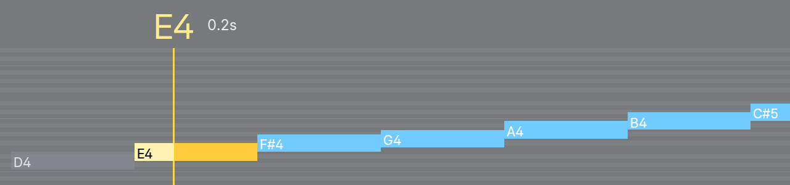
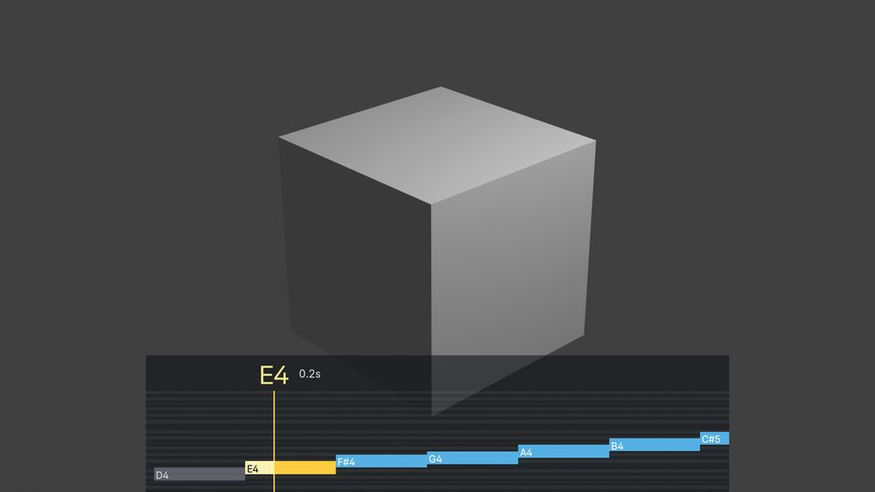
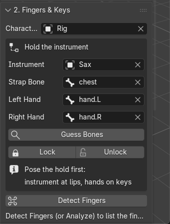

# Step 3: Verify the HUD in Blender's UI

## Summary
New `tests/test_hud_in_ui.py` runs in Blender 5.2.3 with a window and checks all four HUD paths:
the viewport preview, PNG export, ProRes 4444 and the composite scene. Results go to
`tests/out/hud_ui_result.json`, and all 24 checks pass. PNG export and the viewport preview already
worked. The GPU render matches the Pillow render to within 1 px.

Three real bugs are fixed:
1. **ProRes colours were wrong.** The temporary encode scene used AgX, Blender's default view, which
   toned the .mov: gold came out 0.79/0.67/0.41 instead of 1.00/0.80/0.25.
2. **Composite colours were wrong** for the same reason.
3. **The composite offset was wrong** whenever the render percentage wasn't 100%.

ProRes now also stops with a clear message when FFmpeg can't write it. The user chose how the composite
handles colour (see Questions). The Hold box was cut off in the default sidebar width, and that's fixed.

## Acceptance criteria
- [x] `hud_ui_result.json` shows every check passing: `"all_passed": true`, 24 checks, no errors (pasted below).
- [x] Every fix has a reason (see Changes and Problems). CLAUDE.md "Status" is updated, and the new
      test command is in its Testing block.

Plan task by task:
- Export frames 1–30: 30 PNGs, all `(1280, 300, 8-bit, colour type 6 = RGBA)` from their IHDR headers.
  The panel covers the whole frame, so "transparent outside the panel" has no pixels to test as written.
  I checked two things instead:
  (a) where only the panel is drawn, every frame's pixels carry the panel's own straight alpha (0.55)
      and colour, with no premultiplied darkening;
  (b) with the panel alpha set to 0, the empty areas have alpha exactly 0 (62.4% of the frame).
  All 30 frames have gold "active" pixels near the hit line (up to 1710 px).
- GPU vs Pillow at frame 20 (t = 0.7917 s), 7 bars in the layout: the bar masks lie within **1 px** of each
  other (limit 3). Per-row runs are in the JSON, e.g. the active bar row: GPU `[218,276],[286,816]`,
  Pillow `[217,276],[286,816]`.
- ProRes: `hud.mov` is 3,737,135 bytes, the sample entry is `ap4h` (ProRes 4444) with depth 32 (alpha).
  Decoded through Blender, frame 1 equals `hud_0001.png` (mean RGB diff 0.0008, alpha 0.0002, corner alpha 0.549).
  Without ProRes (codec forced unavailable), export cancels with: *"This Blender's FFmpeg can't write ProRes
  4444 with alpha (no ProRes codec). The PNG sequence in … is complete: use it instead."*
- Composite: a scene strip on channel 1 and the HUD image strip on channel 2. The HUD strip is ALPHA_OVER,
  30 frames from frame 1, offset_y −390 for 1080p, so it sits at the bottom. A frame is rendered to
  `tests/out/comp.png`. Colours and percentage results are below.
- Viewport preview: the draw handler ran 4 times with no Python errors. The window screenshot shows the
  HUD at the bottom of the 3D view (1443 hit-line-gold px).
- Hold box: screenshot below. Layout problems were found and fixed.

## Images
In the repo under `docs/plan/reports/step-03/` (small copies; the full-size ones are written to `tests/out/`, which git ignores):
- `hud_0001.png`, `hud_0020.png`: two exported frames (RGBA, 1280×300).
- `comp_standard.jpg`: composite frame 20, Standard view, scaled to 960×540.
- `comp_agx_hud_crop.jpg`: the HUD area of the composite under AgX, showing the toned colours.
- `hold_box.png`: panel 2 with the Hold box after the fix.





## Changes
| File | What changed |
|---|---|
| `tests/test_hud_in_ui.py` | New. Windowed, timer-driven test with 24 checks; writes `tests/out/hud_ui_result.json` and images; exit code 0/1. |
| `midi_animator/blender/hud_draw.py` | `encode_prores`: the temp scene uses the Standard view (it was AgX). Every FFmpeg/ProRes/4444/RGBA setting is checked, with a clear `RuntimeError` naming the PNG sequence as the fallback. Any old `hud.mov` is removed first, and a missing output is an error. `composite_scene`: copies the scene's view transform, look, exposure, gamma, curve flag, display device and sequencer colour space. The HUD strip's colour space comes from `overlay_colorspace`. The offset uses `resolution_y` with no percentage (strip offsets are in full-size pixels). Returns `(scene, warning)`. |
| `midi_animator/core/hud.py` | New `overlay_colorspace(view, look, display, exposure, gamma, curves)` and the measured tables `OVERLAY_EXACT` / `OVERLAY_NEAR`. |
| `tests/core/test_rigs_hud.py` | 2 tests for `overlay_colorspace`. |
| `midi_animator/blender/ops.py` | Make Composite Scene reports a WARNING when the HUD colours will be toned. |
| `midi_animator/blender/ui.py` | Hold box: explicit 38% label splits (labels were cut off as "Instrum…", "Strap B…", "Left Ha…", "Right H…"). Guess Bones is on its own row (it showed "Guess …"). The hint is split into two lines (it showed "Pose the hold first: i…, hands on the keys"). |
| `tests/hud_preview.py` | `frame(path, t, width, height)` returns the transparent Pillow frame. `main()` uses it, with the same output as before. |
| `docs/aerophone-guide.md` | HUD section: ProRes fallback message, and composite colour behaviour (Standard/ACES exact, AgX/Filmic toned with a warning). |
| `docs/decisions/0009-note-hud.md` | Dated note: colour management of the ProRes encode and the composite. |
| `CLAUDE.md` | Status updated, plus the HUD UI test command. |
| `.gitignore` | `tests/out/`. |

## Verification
```
python -m pytest tests/core -q
37 passed in 0.11s

"C:\Program Files\Blender Foundation\Blender 5.2\blender.exe" -b --factory-startup --python tests/test_in_blender.py
... Error: Right hand bone 'nope' not found on Rig: pick it or press Guess    (expected: negative test)
ALL TESTS PASSED

"C:\Program Files\Blender Foundation\Blender 5.2\blender.exe" --command extension validate midi_animator
Success parsing TOML in "midi_animator"

"C:\Program Files\Blender Foundation\Blender 5.2\blender.exe" --factory-startup --window-geometry 0 0 1600 1000 --python tests/test_hud_in_ui.py
... (24 PASS lines)
ALL HUD UI CHECKS PASSED          (process exit code 0, about 1 minute)
```

`tests/out/hud_ui_result.json` (one check per line):
```json
{
  "blender": "5.2.3 LTS",
  "checks": [
    {"name": "export operator finished", "ok": true, "result": ["FINISHED"]},
    {"name": "export wrote 30 PNGs", "ok": true, "count": 30, "first": "hud_0001.png", "last": "hud_0030.png"},
    {"name": "every PNG is 8-bit RGBA at the configured size", "ok": true, "headers": [[1280, 300, 8, 6]]},
    {"name": "background pixels carry the panel's straight alpha/colour in every frame", "ok": true, "panel_rgba": [0.04, 0.05, 0.08, 0.55], "bad_frames": []},
    {"name": "at least one frame has active gold pixels near the hit line", "ok": true, "frames_with_gold": 30, "max_gold_px": 1710},
    {"name": "with panel alpha 0, empty areas are fully transparent (alpha 0)", "ok": true, "max_alpha": 0.0, "transparent_fraction": 0.624},
    {"name": "system Python found for the Pillow render", "ok": true, "python": "C:\\Users\\paulo\\AppData\\Local\\Programs\\Python\\Python313\\python.EXE"},
    {"name": "Pillow render ran", "ok": true, "stderr": ""},
    {"name": "GPU and Pillow renders have the same bars within 3 px", "ok": true, "time_s": 0.7917, "bars_in_layout": 7, "bar_px_gpu": 35674, "bar_px_pillow": 37078, "differing_px": 1404, "max_edge_distance_px": 1, "runs_gpu": {"50": [[18, 276], [286, 416]], "64": [[218, 276], [286, 816]], "79": [[417, 1016]], "86": [[617, 1016]], "100": [[817, 1215]], "115": [[1017, 1279]], "129": [[1216, 1279]]}, "runs_pillow": {"50": [[18, 276], [286, 417]], "64": [[217, 276], [286, 816]], "79": [[417, 1016]], "86": [[617, 1016]], "100": [[816, 1216]], "115": [[1016, 1279]], "129": [[1216, 1279]]}},
    {"name": "ProRes export finished and hud.mov is over 0 bytes", "ok": true, "result": ["FINISHED"], "bytes": 3737135},
    {"name": "hud.mov is ProRes 4444 with an alpha channel (ap4h, depth 32)", "ok": true, "fourcc_found": true, "depth": 32},
    {"name": "decoded ProRes frame 1 matches hud_0001.png (mean abs diff < 0.02, alpha kept)", "ok": true, "size": [1280, 300], "mean_alpha_diff": 0.0002359693025937304, "mean_rgb_diff": 0.0007629970205016434, "corner_alpha": 0.5488364696502686},
    {"name": "without a ProRes codec, export stops with a clear message", "ok": true, "message": "This Blender's FFmpeg can't write ProRes 4444 with alpha (no ProRes codec). The PNG sequence in C:\\repos\\blender-midi-animator\\tests\\out\\hud is complete: use it instead.", "operator_result": ["CANCELLED (error reported)"], "operator_error": "Error: This Blender's FFmpeg can't write ProRes 4444 with alpha (no ProRes codec). The PNG sequence in C:\\repos\\blender-midi-animator\\tests\\out\\hud\\ is complete: use it instead."},
    {"name": "composite operator finished and created the scene", "ok": true, "result": ["FINISHED"]},
    {"name": "composite has a scene strip and a HUD image strip above it", "ok": true, "strips": [["Scene", "SCENE", 1], ["HUD", "IMAGE", 2]]},
    {"name": "HUD strip is ALPHA_OVER, 30 frames, offset to the bottom", "ok": true, "blend": "ALPHA_OVER", "frames": 30, "offset_y": -390.0, "expected_offset_y": -390.0, "start": 1},
    {"name": "HUD strip colour space follows the scene's view (factory AgX -> AgX Base sRGB)", "ok": true, "view": "AgX", "strip_colorspace": "AgX Base sRGB"},
    {"name": "composite (Standard): scene as rendered directly, HUD gold within 2%, no warning", "ok": true, "view": "Standard", "strip_colorspace": "sRGB", "scene_vs_direct_mean_diff": 0.0, "gold": [1.0, 0.8, 0.251], "gold_max_err": 0.001, "hud_region_mean_diff": 0.001, "warning": null, "image": "tests/out/comp.png"},
    {"name": "composite (ACES 2.0): scene as rendered directly, HUD gold within 2%, no warning", "ok": true, "view": "ACES 2.0", "strip_colorspace": "ACES 2.0 sRGB", "scene_vs_direct_mean_diff": 0.0, "gold": [1.0, 0.8, 0.251], "gold_max_err": 0.001, "hud_region_mean_diff": 0.0109, "warning": null, "image": "tests/out/comp_ACES_2.0.png"},
    {"name": "composite (AgX): scene as rendered directly, and a warning that the HUD is toned", "ok": true, "view": "AgX", "strip_colorspace": "AgX Base sRGB", "scene_vs_direct_mean_diff": 0.0, "gold": [0.859, 0.725, 0.318], "gold_max_err": 0.141, "hud_region_mean_diff": 0.0097, "warning": "The HUD colours are toned by this scene's view transform 'AgX'. For exact colours, overlay the exported PNGs or ProRes on your render in a video editor", "image": "tests/out/comp_AgX.png"},
    {"name": "composite at 50%: the HUD's hit line runs from the bottom edge up to the band", "ok": true, "frame": [960, 540], "column": 301, "gold_rows": [0, 110], "expected_rows": [0, 111.0]},
    {"name": "viewport draw handler ran without Python errors", "ok": true, "draw_calls": 4, "errors": []},
    {"name": "viewport screenshot shows the HUD (hit-line gold at the bottom of the 3D view)", "ok": true, "gold_px": 1443, "screenshot": "tests/out/viewport.png"},
    {"name": "Hold box screenshot written (look at it)", "ok": true, "screenshot": "tests/out/hold_box.png", "sidebar_width": 350, "category": "MIDI", "hold_bones": ["chest", "hand.L", "hand.R"]}
  ],
  "errors": [],
  "hold_bones": ["chest", "hand.L", "hand.R"],
  "prores_operator_error": "Error: This Blender's FFmpeg can't write ProRes 4444 with alpha (no ProRes codec). The PNG sequence in C:\\repos\\blender-midi-animator\\tests\\out\\hud\\ is complete: use it instead.",
  "all_passed": true
}
```

ProRes before and after the view fix. I encoded the same 30 PNGs twice in `-b` and decoded frame 1:

| Temp scene view | mean RGB diff vs PNG | active gold (target 1.00/0.80/0.25) |
|---|---|---|
| AgX (default, before) | 0.0349 | 0.788/0.668/0.408 |
| Standard (after) | 0.0008 | 0.995/0.797/0.251 |

## Deviations from the plan or spec
- "Fully transparent outside the panel": the panel covers the whole frame, so I tested what the check is
  for instead (see the export criteria above).
- The Pillow comparison compares bar masks (each within N px of the other), not matched bar boxes. Touching
  bars in neighbouring lanes merge into one connected area, so per-box matching was meaningless.
- The Pillow side runs in the system Python (`python` on PATH, with Pillow) as a subprocess, because
  Blender's Python has no Pillow.
- To screenshot the Hold box, the test opens panel 2 by clearing `DEFAULT_CLOSED` before `register()`,
  and turns off the splash screen. Both affect only the test session.

## Decisions
- **Composite colour (the user's choice, recorded in ADR 0009's note).** Copy the scene's view so the render
  looks the same as when rendered directly. Read the HUD strip in the display space that matches that view.
  Exactness must be verified with a pixel test (gold within 2%), and otherwise the operator warns.
  Measured in Blender 5.2.3, with the HUD alpha-over a scene strip at frame 20. The scene area equals a
  direct render in every case (mean diff 0.0):

  | Scene view | HUD strip colour space | Gold out | Result |
  |---|---|---|---|
  | Standard | sRGB | 1.000/0.800/0.251 | exact |
  | ACES 1.3 | ACES 1.3 sRGB | 1.000/0.804/0.251 | exact (probe only) |
  | ACES 2.0 | ACES 2.0 sRGB | 1.000/0.800/0.251 | exact (in the test) |
  | Filmic | Filmic sRGB | 1.000/0.804/0.275 | 2.5% off, so toned + warning (plain sRGB: 0.808/0.729/0.278) |
  | AgX (default) | AgX Base sRGB | 0.859/0.725/0.318 | toned + warning (plain sRGB: 0.796/0.675/0.412) |
  | Khronos PBR Neutral | sRGB | 0.941/0.749/0.188 (opaque patch) | toned + warning (its own sRGB space was worse) |

  **Which case happened:** exact for Standard and ACES. For AgX, the view every new Blender scene starts
  with, it's the **fallback**. The scene's view is kept and the operator warns that the HUD colours are toned. For AgX and
  Filmic I kept the near-inverse space ("AgX Base sRGB" / "Filmic sRGB") rather than plain sRGB, because
  every default HUD colour came out closer with it (worst channel: AgX 0.14 vs 0.23, Filmic 0.025 vs 0.19).
  The user's fallback said only "keep the scene's view and warn", so this detail is my call. Easy to
  revert by removing `OVERLAY_NEAR`.
- A Look, exposure, gamma, curves, or a display other than sRGB also triggers the warning, because they tone the HUD too.

## Problems and risks
- **The ACES views blend the translucent panel slightly off.** Opaque HUD colours come out exact, but
  the 55% panel is blended before the view transform. The mean diff over the HUD area is 0.011, against
  0.001 for Standard. Not visible at a glance.
- The `overlay_colorspace` tables are measurements from Blender 5.2.3's OCIO config. A future config may change them.
  `tests/test_hud_in_ui.py` re-measures Standard, ACES 2.0 and AgX each run.
- In a timer, `scene.frame_set()` on a scene that isn't the window's scene didn't change what
  `render.render(scene=…)` rendered. The first composite render showed frame 1. Setting `frame_current`
  works, so the test does that. The operators aren't affected.
- The viewport preview centres the HUD on the whole 3D-view region, so with the sidebar open its right part
  is hidden under the sidebar (`tests/out/viewport.png`). It isn't broken, so I didn't change it.
- The test needs a system Python with Pillow on PATH for one check. Without it, that check fails rather than skips.

## Follow-ups for the planner
- Fix the other cut-off labels in the default sidebar width, outside the Hold box: "Charact…" (panel 2 rig),
  "Instrum…" (panel 1), and "Detect Fingers (or Analyze) to list the fin…".
- Make the viewport preview avoid the sidebar (use the region's visible width when region overlap is on), or
  add a horizontal position option.
- Consider a "Standard view" toggle on Make Composite Scene for users who want an exact HUD over a Standard-look render.
- Step 6 (trial): look at the HUD over the real take in Resolve, and try Make Composite Scene with the user's
  AgX scene so they judge the toned HUD.

## Questions for the user
- **Composite colour.** In a sequencer render Blender applies one view transform to every strip, so with
  AgX either the render or the HUD can't be exact. Which should win?
  **Answer:** copy the scene's view so the render looks exactly as when rendered directly. Then try to keep
  the HUD exact with the display-referred colour space that matches the view, verified by a pixel test
  (gold within 2% of 1.00/0.80/0.25). If Blender 5.2 can't do it, or the scene uses a Look, keep the
  scene's view and warn that the Resolve overlay is the exact path. Record which case happened.
  Done as above. AgX can't be inverted, so the AgX case is the fallback with a warning.
